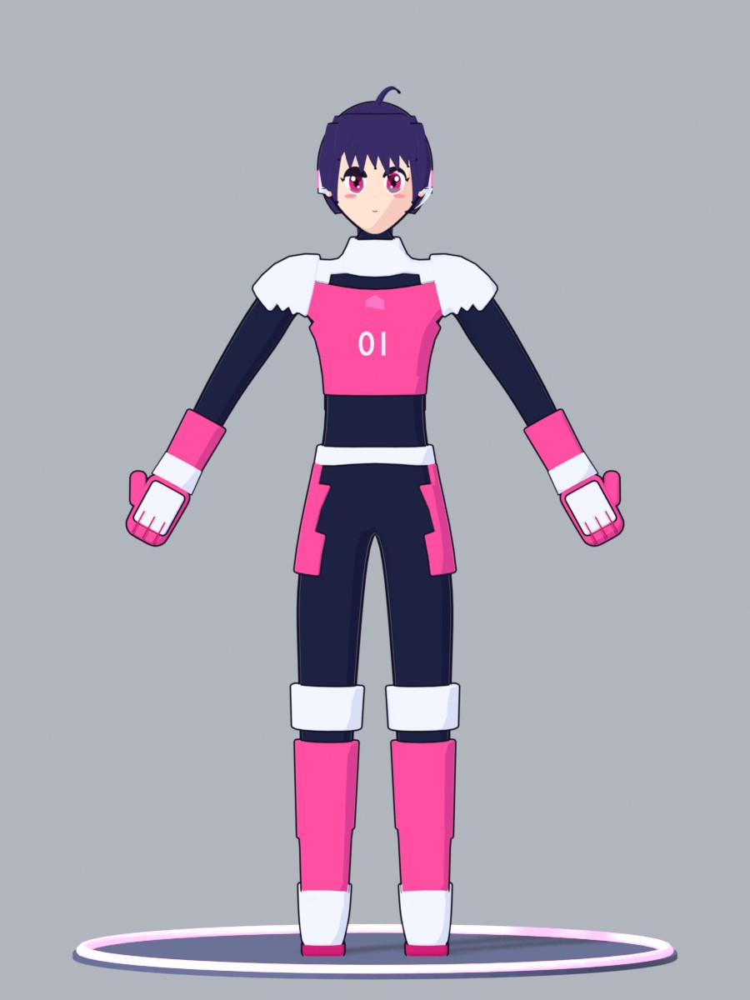
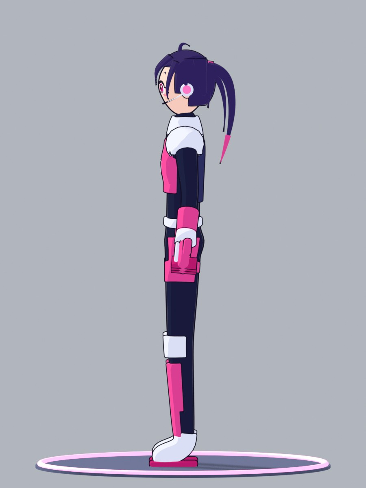
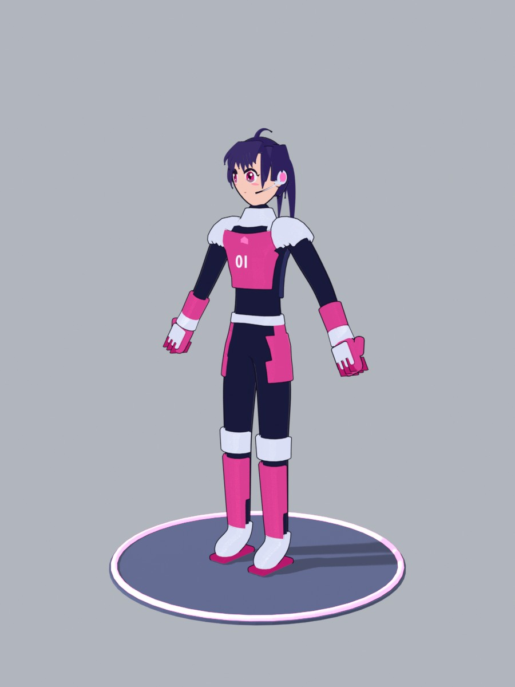
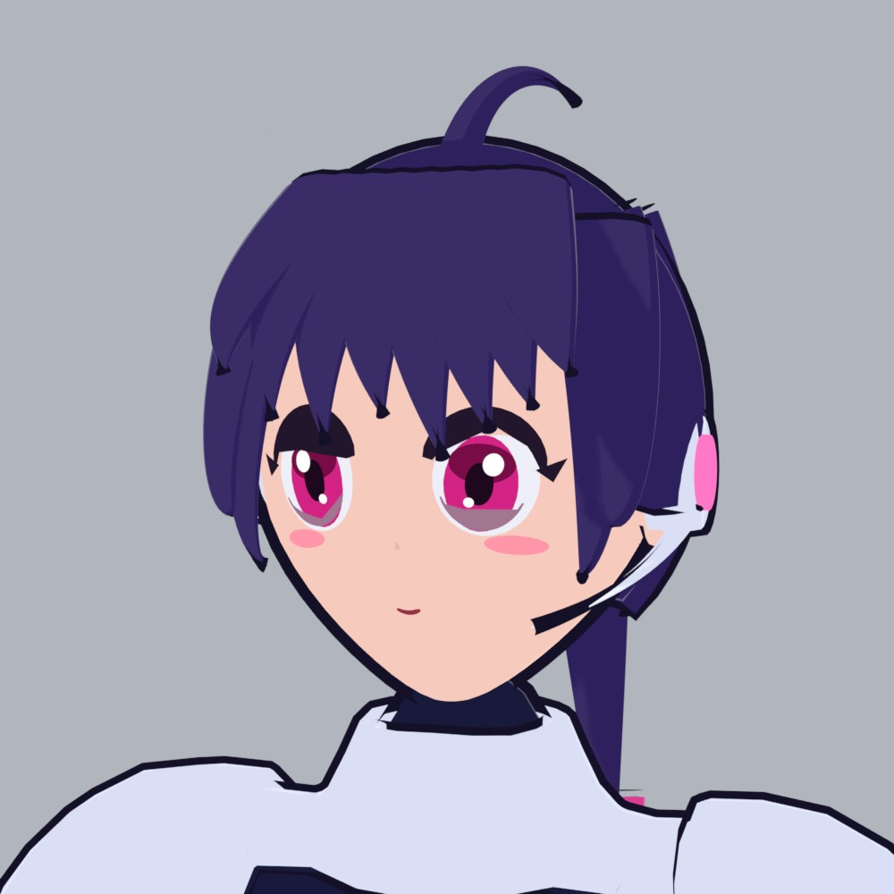
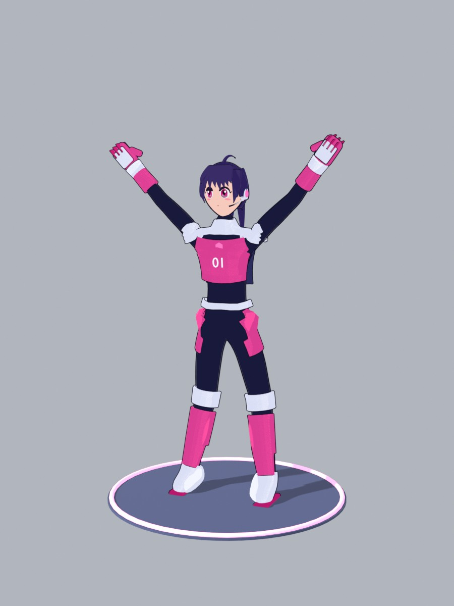

# キーパーモデル 1体目（TEAM PINK）— 承認待ち

指示書に従い、**この1体だけを作り、ゲームにはまだ組み込んでいません**。承認をもらってから、もう1体のキーパー・CPU選手・プレイヤーの腕に展開します。

## 画像
| 正面 | 横 | 45° |
|---|---|---|
|  |  |  |

| 顔のアップ | 参考：ゲーム内のYスタンス（リグの変形確認） |
|---|---|
|  |  |

## 仕様
- 身長1.78 m（ゲームでは1.25倍で、約2.2 m）。チームカラーはPINK（ピンク・白・紺）、背番号01。
- デザイン：
  - 胸当て・肩パッド・膝パッド・すね当て・ブーツ
  - 大きなキーパーグローブ（親指と指の溝あり）
  - チーム通信用のヘッドセット（耳のパーツが光る）
  - ポニーテール、毛先はピンク
- 顔：アニメ調の大きな目（白目・虹彩・瞳孔・ハイライト2つ・上まつげ・下まつげ）、眉、口、頬の赤み。
- リグ：19本の骨。hips, spine, chest, neck, head と、左右それぞれ shoulder, upper_arm, forearm, hand, thigh, shin, foot。
  - 体と防具は自動ウェイトです。
  - 頭・髪・顔のパーツは head、グローブは hand に100%で付けています。
- レンダー画像：BlenderのEEVEEで、トゥーンのランプシェーダーと反転ハル方式の輪郭線を使っています（ゲームと同じ考え方）。

## ファイル（`assets/keeper/`）
| ファイル | 内容 |
|---|---|
| keeper_pink.glb | glTFバイナリ（約2.5 MB、92メッシュ、スキン1つ）。輪郭線は含みません（ゲーム側のトゥーンと輪郭線を使うため）。マテリアルは基本色のPBR |
| keeper_pink.blend | Blenderのソース（輪郭線とトゥーンマテリアル付き） |
| build_keeper.py | モデルをゼロから生成するスクリプト（bpy 5.2） |
| render_keeper.py | 正面・横・45°・顔・スタンスの画像を書き出す |
| export_glb.py | .blend から .glb を書き出す |

## 確認したこと
- Three.js r180 の GLTFLoader で読み込み、92メッシュすべてがSkinnedMesh で、19本の骨があることを確認しました。上腕の骨を回すと、腕とグローブが一緒に動くことも確認しました（`tools/glb_check.html`）。

## 承認後の統合で必要な作業（見積もり）
1. 同じマテリアルのメッシュを結合して、描画の呼び出し回数を減らす（92 → 約20）。
2. 今の手続き的なキャラクター（`character.js`）のポーズ（keeper / saveL / saveR / celebrate / conceded）を、この骨格へ移す。
3. 当たり判定のカプセルを、このモデルの関節から測り直す（測り方は今と同じ）。
4. CYAN用の色違い（もう1体のキーパー）を作る。

## 既知の弱点（承認前に直すかどうか相談したい点）
- 横から見ると胴が薄く見えます。鼻と顎の立体感はアニメ調として最小限にしています。
- グローブはミトン型で、指は分かれていません（溝だけ）。
- 髪の毛束は板状のリボンです。頭頂部は単色です。
